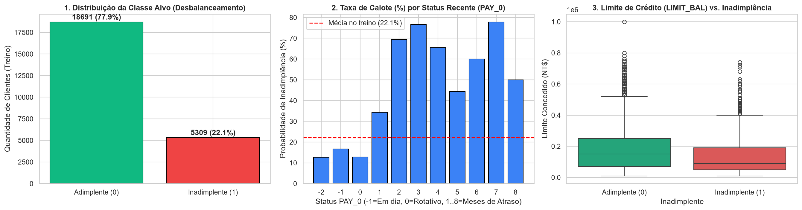
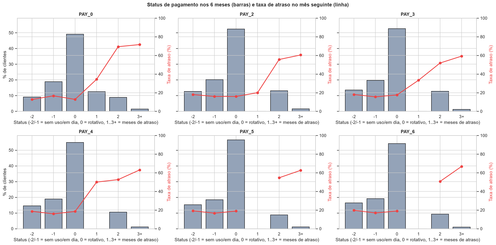
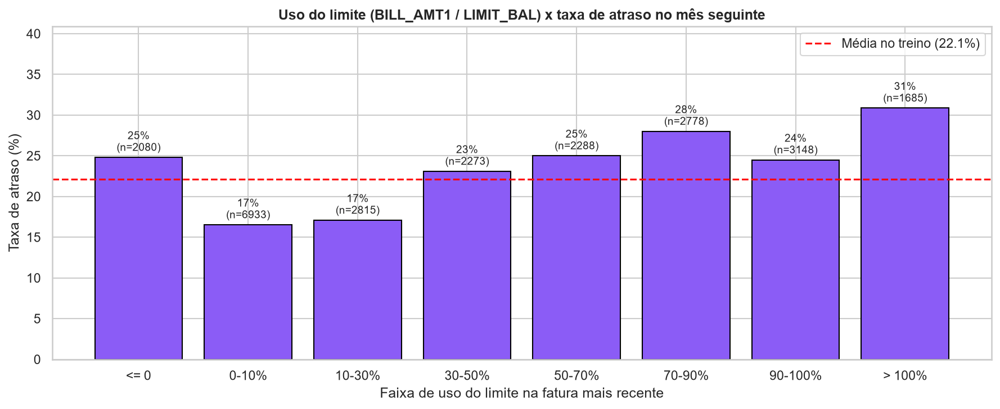
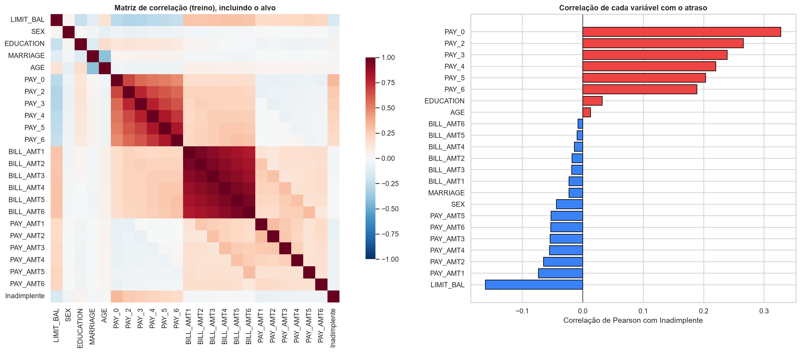
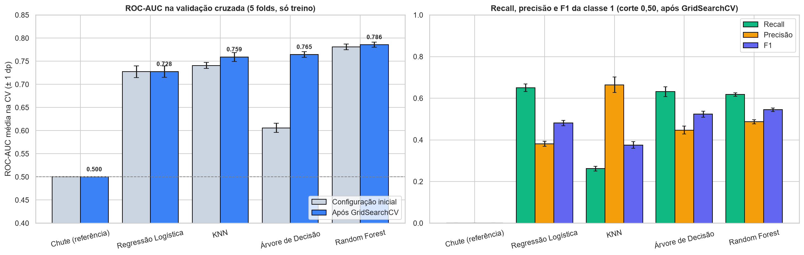
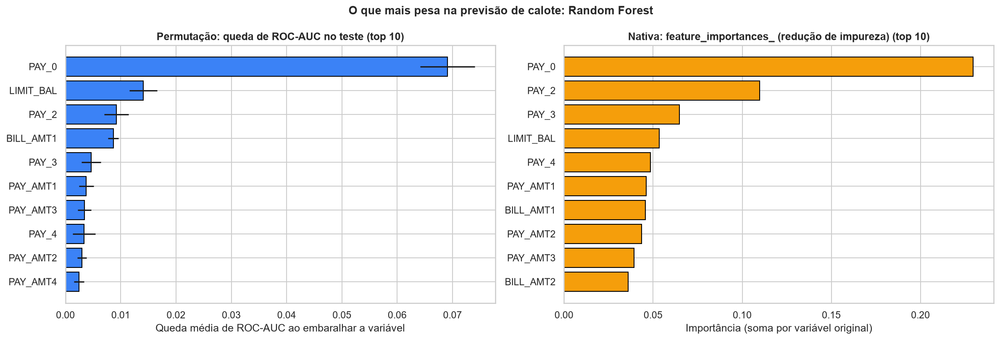
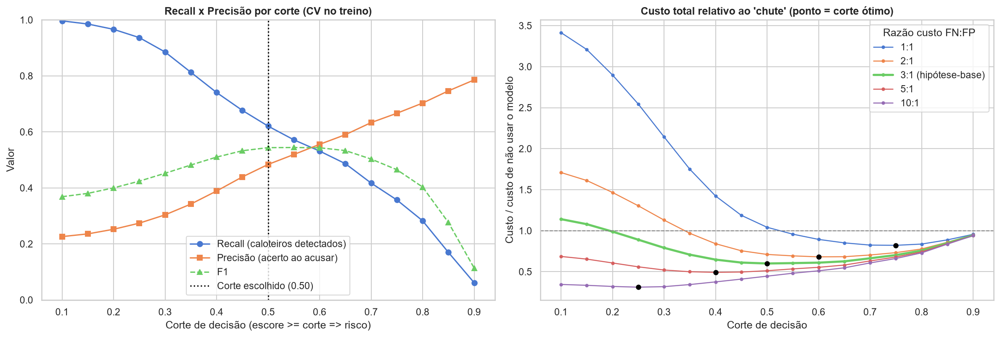

# 02. Coleta de Dados, Análise Exploratória e Modelagem

[Anterior: 01. Contexto e Negócio](01_contexto_e_perguntas_de_negocio.md) | [Voltar ao README](../README.md) | [Próximo: 03. Resultados](03_resultados_tecnicos_e_negocio.md)

---

## 1. Coleta de Dados e Avaliação da Fonte

Os dados provêm da base pública **Default of Credit Card Clients** (*UCI Machine Learning Repository*, Yeh & Lien, 2009), armazenada em `data/UCI_Credit_Card.csv`:

* **Volume:** $30.000$ registros de clientes.
* **Variáveis originais:** $23$ atributos preditores, englobando limite de crédito (`LIMIT_BAL`), perfil demográfico (`SEX`, `EDUCATION`, `MARRIAGE`, `AGE`), status de pagamento dos últimos 6 meses (`PAY_0`, `PAY_2` a `PAY_6`), valores de faturas (`BILL_AMT1` a `BILL_AMT6`) e valores pagos (`PAY_AMT1` a `PAY_AMT6`).
* **Variável alvo (`default.payment.next.month`):** Binária, com **$22,12\%$ de inadimplentes (classe $1$)** e **$77,88\%$ de adimplentes (classe $0$)**.

### Avaliação de Disponibilidade e Fonte Única
* **Disponibilidade:** Base pública, estruturada e sem valores ausentes, permitindo concentrar o esforço no rigor metodológico do pipeline de Machine Learning exigido em C318.
* **Fonte única:** Todos os registros pertencem a uma única instituição financeira de Taiwan (abril a setembro de 2005), sem cruzamento com fontes externas (como renda comprovada, bureaus de crédito ou indicadores macroeconômicos). Essa restrição é detalhada em [`04_limitacoes_e_proximos_passos.md`](04_limitacoes_e_proximos_passos.md).

---

## 2. Separação Treino/Teste e Prevenção de *Data Leakage*

Seguindo a diretriz central da disciplina, a divisão estratificada (`stratify=y`) foi feita **antes** de qualquer análise exploratória profunda, transformação estatística ou seleção de modelos:

* **Treino ($80\%$):** $24.000$ clientes ($5.309$ inadimplentes e $18.691$ adimplentes) — utilizados exclusivamente para EDA, validação cruzada em **5 *folds***, `GridSearchCV`, teste de ablação de atributos sensíveis e escolha do ponto de corte.
* **Teste ($20\%$):** $6.000$ clientes ($1.327$ inadimplentes e $4.673$ adimplentes) — isolados e avaliados **uma única vez** ao final.

Para comprovar a ausência de vazamento de dados, a suíte automatizada (`backend/tests/`) inclui um teste que **embaralha os dados do conjunto de teste** e confirma que nenhuma decisão de modelagem (modelo vencedor, hiperparâmetros ou ponto de corte) se altera.

---

## 3. Análise Exploratória de Dados (EDA) e Pré-Processamento

Toda a análise exploratória foi conduzida exclusivamente sobre os $24.000$ clientes de treino (registrada em `notebooks/analise_e_modelagem_c318.ipynb` e `resultados/eda_*.png`), revelando quatro padrões centrais:

1. **Desbalanceamento e efeito acentuado de `PAY_0` e `LIMIT_BAL`:**  
   No treino, $18.691$ clientes ($77,9\%$) são adimplentes e $5.309$ ($22,1\%$) são inadimplentes. Para `PAY_0` em `-2`, `-1` ou `0`, a taxa de atraso fica abaixo da média ($\approx 13\%$ a $17\%$). Com **1 mês de atraso (`PAY_0 = 1`)**, a taxa sobe para **$\approx 34\%$**; com **2 meses (`PAY_0 = 2`)**, dispara para **$\approx 69\%$**; e com **3 meses (`PAY_0 = 3`)**, alcança **$\approx 77\%$**. Além disso, clientes inadimplentes concentram-se em faixas de limite (`LIMIT_BAL`) visivelmente menores (mediana em torno de $90.000$ NT\$ contra $\approx 150.000$ NT\$ entre adimplentes).

   

2. **Persistência do atraso ao longo dos 6 meses (`PAY_0` a `PAY_6`):**  
   Em todos os 6 meses, cerca de metade da carteira permanece no status `0` (rotativo) com taxa de atraso moderada ($\approx 13\%$ a $18\%$). Sempre que surge atraso igual ou superior a 2 meses (`2` ou `3+`), a taxa de inadimplência no mês seguinte salta para a faixa de **$50\%$ a $70\%$**, com maior intensidade no mês mais recente (`PAY_0`). Observa-se ainda uma peculiaridade estrutural da base UCI: o status `1` aparece em cerca de $12\%$ dos clientes em `PAY_0`, mas é praticamente inexistente nos meses mais antigos (`PAY_2` a `PAY_6`).

   

3. **Relação não linear entre uso do limite (`BILL_AMT1 / LIMIT_BAL`) e inadimplência:**  
   A taxa de atraso é menor entre clientes que usam **$0\%$ a $30\%$ do limite ($17\%$)**, cresce progressivamente conforme o comprometimento sobe (**$23\%$** em $30\text{–}50\%$, **$25\%$** em $50\text{–}70\%$, **$28\%$** em $70\text{–}90\%$) e atinge o pico de **$31\%$** quando o cliente **ultrapassa $100\%$ do limite ($n = 1.685$)**. Um comportamento não monótono também aparece na faixa **`<= 0` ($25\%$, $n = 2.080$)**, que engloba faturas zeradas ou com saldo credor/estornos acima da média global ($22,1\%$). Essa não linearidade ajuda a explicar a superioridade de modelos baseados em árvores frente à Regressão Logística.

   

4. **Multicolinearidade entre faturas e baixa correlação linear de dados demográficos:**  
   A matriz de correlação evidencia forte colinearidade entre `BILL_AMT1`–`BILL_AMT6` e entre `PAY_0`–`PAY_6`. Na correlação de Pearson com o alvo, lideram positivamente `PAY_0` ($\approx +0,33$) até `PAY_6` ($\approx +0,19$) e negativamente `LIMIT_BAL` ($\approx -0,16$) e `PAY_AMT1` ($\approx -0,07$). Já `AGE`, `EDUCATION`, `MARRIAGE`, `SEX` e os valores brutos das faturas (`BILL_AMT1`–`BILL_AMT6`) apresentam correlação linear próxima de zero com o atraso.

   

### Pré-processamento em Pipeline
Códigos não documentados em `EDUCATION` (`0`, `5`, `6`) e `MARRIAGE` (`0`) são padronizados na etapa de preparação, e todas as transformações (escalonamento e codificação) permanecem encapsuladas dentro do `Pipeline` do Scikit-Learn para evitar qualquer vazamento entre os *folds*.

---

## 4. Comparação de Modelos e Ajuste de Hiperparâmetros (Validação Cruzada em 5 *Folds*)

Foram comparados **5 modelos** exclusivamente via validação cruzada estratificada em **5 *folds*** sobre os $24.000$ clientes de treino, em duas etapas: **configuração inicial** (diagnóstico de *overfitting*) e **pós-`GridSearchCV`** (otimizando ROC-AUC).

### 4.1. Diagnóstico Inicial (Antes do `GridSearchCV`)

| Modelo | ROC-AUC (CV) | ROC-AUC (Treino) | PR-AUC (CV) | Recall (CV) | Precisão (CV) | $F_1$ (CV) |
| :--- | :---: | :---: | :---: | :---: | :---: | :---: |
| **Chute (referência)** | $0,5000 \pm 0,0000$ | $0,5000$ | $0,2212 \pm 0,0001$ | $0,0000$ | $0,0000$ | $0,0000$ |
| **Regressão Logística** | $0,7275 \pm 0,0127$ | $0,7305$ | $0,5045 \pm 0,0145$ | $0,6506 \pm 0,0183$ | $0,3817 \pm 0,0123$ | $0,4811 \pm 0,0130$ |
| **KNN** | $0,7407 \pm 0,0064$ | $1,0000$ | $0,4970 \pm 0,0097$ | $0,3432 \pm 0,0088$ | $0,6241 \pm 0,0179$ | $0,4428 \pm 0,0115$ |
| **Árvore de Decisão** | $0,6059 \pm 0,0100$ | $1,0000$ | $0,2850 \pm 0,0082$ | $0,3871 \pm 0,0201$ | $0,3854 \pm 0,0133$ | $0,3862 \pm 0,0161$ |
| **Random Forest** | $0,7811 \pm 0,0060$ | $0,8798$ | $0,5565 \pm 0,0098$ | $0,5924 \pm 0,0067$ | $0,5030 \pm 0,0077$ | $0,5440 \pm 0,0054$ |

> **Diagnóstico de *overfitting* (conceito central de C318):** Sem regularização, tanto a **Árvore de Decisão** quanto o **KNN** atingiram ROC-AUC de **$1,0000$ no treino**, mas caíram para $0,6059$ e $0,7407$ na validação cruzada — um exemplo clássico de excesso de flexibilidade memorizando ruído.

### 4.2. Comparação Pós-`GridSearchCV` (Validação Cruzada em 5 *Folds* no Treino)

| Modelo | Melhores Hiperparâmetros | ROC-AUC (CV) | PR-AUC (CV) | Recall (CV) | Precisão (CV) | $F_1$ (CV) | Ajuste (s) | Predição (s) |
| :--- | :--- | :---: | :---: | :---: | :---: | :---: | :---: | :---: |
| **Chute (referência)** | `{}` | $0,5000 \pm 0,0000$ | $0,2212 \pm 0,0001$ | $0,0000$ | $0,0000$ | $0,0000$ | $0,13$ | $0,03$ |
| **Regressão Logística** | `{'C': 10.0}` | $0,7276 \pm 0,0127$ | $0,5045 \pm 0,0144$ | $0,6508 \pm 0,0181$ | $0,3815 \pm 0,0120$ | $0,4809 \pm 0,0127$ | $0,15$ | $0,02$ |
| **KNN** | `{'n_neighbors': 301, 'weights': 'uniform'}` | $0,7592 \pm 0,0094$ | $0,5167 \pm 0,0160$ | $0,2616 \pm 0,0113$ | $0,6644 \pm 0,0374$ | $0,3753 \pm 0,0163$ | $0,04$ | $2,90$ |
| **Árvore de Decisão** | `{'max_depth': 8, 'min_samples_leaf': 500}` | $0,7645 \pm 0,0060$ | $0,5224 \pm 0,0107$ | $0,6316 \pm 0,0236$ | $0,4472 \pm 0,0184$ | $0,5233 \pm 0,0145$ | $0,26$ | $0,05$ |
| **Random Forest (Vencedor)** | `{'max_depth': None, 'min_samples_leaf': 20, 'n_estimators': 500}` | **$0,7857 \pm 0,0053$** | **$0,5576 \pm 0,0119$** | **$0,6180 \pm 0,0084$** | **$0,4871 \pm 0,0095$** | **$0,5448 \pm 0,0086$** | $22,18$ | $0,66$ |

O controle de complexidade no `GridSearchCV` recuperou drasticamente a generalização da Árvore de Decisão (de $0,6059$ para $0,7645$) e do KNN (de $0,7407$ para $0,7592$). Ainda assim, o **Random Forest** venceu com folga em ROC-AUC ($0,7857$), PR-AUC ($0,5576$) e $F_1$-Score ($0,5448$), com baixo desvio-padrão entre os 5 *folds*.

---

## 5. Decisão sobre Atributos Sensíveis (`SEX`, `AGE` e `MARRIAGE`)

Avaliou-se em validação cruzada pareada por *fold* o impacto de remover **sexo, idade e estado civil** do modelo vencedor (mantendo `EDUCATION` e as $19$ variáveis financeiras/comportamentais, totalizando **$20$ variáveis**):

| Configuração (Random Forest) | ROC-AUC (CV) | PR-AUC (CV) | Recall (CV) | Precisão (CV) | $F_1$ (CV) |
| :--- | :---: | :---: | :---: | :---: | :---: |
| **Com `SEX`, `AGE` e `MARRIAGE`** | $0,7857 \pm 0,0053$ | $0,5576 \pm 0,0119$ | $0,6180 \pm 0,0084$ | $0,4871 \pm 0,0095$ | $0,5448 \pm 0,0086$ |
| **Sem `SEX`, `AGE` e `MARRIAGE` (mesmos hiperparâmetros)** | $0,7845 \pm 0,0055$ | $0,5560 \pm 0,0102$ | $0,6206 \pm 0,0028$ | $0,4839 \pm 0,0071$ | $0,5438 \pm 0,0046$ |
| **Sem `SEX`, `AGE` e `MARRIAGE` (`GridSearchCV` refeito)** | $0,7845 \pm 0,0055$ | $0,5560 \pm 0,0102$ | $0,6206 \pm 0,0028$ | $0,4839 \pm 0,0071$ | $0,5438 \pm 0,0046$ |
| **Diferença pareada por *fold* (com $-$ sem)** | **$+0,0012 \pm 0,0009$** | $+0,0016 \pm 0,0030$ | — | — | $+0,0010 \pm 0,0042$ |

* **Decisão aplicada (configurável no topo de `backend/analise_e_modelagem_c318.py`):** **Não utilizar** `SEX`, `AGE` e `MARRIAGE`. Mesmo refazendo o `GridSearchCV` do zero sem essas colunas, os hiperparâmetros ótimos permaneceram idênticos (`max_depth=None`, `min_samples_leaf=20`, `n_estimators=500`). A queda na ROC-AUC é consistente entre os *folds*, porém muito pequena ($0,0012$), justificando a exclusão para reduzir risco de viés discriminatório.

---

## 6. Importância dos Atributos (Modelo Final — 20 Variáveis)

As $6$ variáveis mais relevantes medidas por **importância por permutação** (queda média de ROC-AUC no conjunto de teste ao embaralhar cada variável), comparadas à importância nativa por redução de impureza (`feature_importances_`):

| Posição (Permutação) | Variável | Queda de ROC-AUC (Permutação) | Importância Nativa (Impureza) | Posição Nativa |
| :---: | :--- | :---: | :---: | :---: |
| **1** | `PAY_0` (Status no último mês) | **$0,0691 \pm 0,0049$** | $0,2296$ | 1 |
| **2** | `LIMIT_BAL` (Limite de crédito) | $0,0141 \pm 0,0025$ | $0,0536$ | 4 |
| **3** | `PAY_2` (Status há 2 meses) | $0,0092 \pm 0,0022$ | $0,1097$ | 2 |
| **4** | `BILL_AMT1` (Fatura mais recente) | $0,0087 \pm 0,0009$ | $0,0458$ | 7 |
| **5** | `PAY_3` (Status há 3 meses) | $0,0047 \pm 0,0018$ | $0,0647$ | 3 |
| **6** | `PAY_AMT1` (Pagamento mais recente) | $0,0038 \pm 0,0013$ | $0,0462$ | 6 |

> Na base da tabela (`resultados/importancia_atributos.csv`), variáveis antigas como `BILL_AMT4` ($-0,00002$), `EDUCATION` ($-0,00024$), `PAY_AMT5` ($-0,00042$) e `BILL_AMT6` ($-0,00043$) apresentam queda de ROC-AUC estatisticamente indistinguível de zero.

---

## 7. Definição do Ponto de Corte pelo Custo dos Erros

A escolha do limiar de decisão foi conduzida *out-of-fold* na validação cruzada de treino ($N = 24.000$), minimizando o custo ponderado $\text{Custo} = r \cdot \text{FN} + 1 \cdot \text{FP}$ para diferentes razões $r$ entre o custo de um Falso Negativo (calote não previsto) e de um Falso Positivo (abordagem desnecessária a um bom pagador):

| Razão de Custo (FN : FP) | Limiar Ótimo | Custo Mínimo (Treino OOF) | Recall (OOF) | Precisão (OOF) | $F_1$ (OOF) |
| :---: | :---: | :---: | :---: | :---: | :---: |
| $1 : 1$ | $0,75$ | $4.362$ | $35,69\%$ | $66,65\%$ | $0,4649$ |
| $2 : 1$ | $0,60$ | $7.232$ | $53,16\%$ | $55,55\%$ | $0,5433$ |
| **$3 : 1$ (Hipótese-base)** | **$0,50$** | **$9.558$** | **$62,06\%$** | **$48,38\%$** | **$0,5437$** |
| $5 : 1$ | $0,40$ | $13.064$ | $74,06\%$ | $38,89\%$ | $0,5100$ |
| $10 : 1$ | $0,25$ | $16.531$ | $93,67\%$ | $27,41\%$ | $0,4241$ |

No gráfico abaixo, o painel esquerdo mostra o *trade-off* clássico entre Recall e Precisão (com o $F_1$ atingindo seu platô máximo justamente em $0,50\text{–}0,55$). O painel direito compara o custo total relativo ao *baseline* ("chute" $= 1,0$): sob a razão **$3:1$**, o corte ótimo em **$0,50$** reduz o custo estimado para cerca de **$0,60$** do custo de não usar o modelo (no treino OOF: $VP = 3.295$, $FP = 3.516$, $FN = 2.014$, $VN = 15.175$).

---

[Anterior: 01. Contexto e Negócio](01_contexto_e_perguntas_de_negocio.md) | [Voltar ao README](../README.md) | [Próximo: 03. Resultados](03_resultados_tecnicos_e_negocio.md)