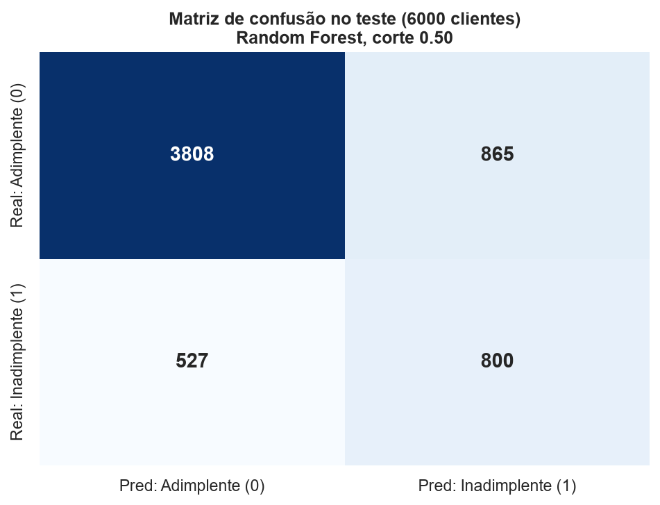

# 03. Análise de Resultados (Visão Técnica e de Negócio)

[Anterior: 02. Coleta e Modelagem](02_coleta_e_modelagem.md) | [Voltar ao README](../README.md) | [Próximo: 04. Limitações](04_limitacoes_e_proximos_passos.md)

---

Todos os resultados finais foram obtidos sobre o **conjunto de teste isolado ($6.000$ clientes: $1.327$ inadimplentes e $4.673$ adimplentes)**, utilizado **uma única vez**. Os valores abaixo correspondem exatamente a `resultados/avaliacao_teste.csv`, `resultados/avaliacao_teste.json`, `backend/modelo_credito.joblib` (especificado em [`backend/ARTEFATO_MODELO.md`](../backend/ARTEFATO_MODELO.md)) e às respostas da API.

---

## 1. Visão para a Equipe Técnica (Ciência de Dados)

### 1.1. Desempenho Final no Conjunto de Teste ($N = 6.000$)

| Modelo | Limiar | Acurácia | Precisão | Recall | $F_1$-Score | ROC-AUC | PR-AUC |
| :--- | :---: | :---: | :---: | :---: | :---: | :---: | :---: |
| **Chute (referência)** | $0,50$ | $77,88\%$ | $0,00\%$ | $0,00\%$ | $0,0000$ | $0,5000$ | $0,2212$ |
| **Random Forest (modelo final)** | $0,50$ | **$76,80\%$** | **$48,05\%$** | **$60,29\%$** | **$0,5348$** | **$0,7734$** | **$0,5486$** |

### 1.2. Matriz de Confusão no Conjunto de Teste ($N = 6.000$)

| Realidade \ Predição | Previsto: Adimplente ($0$) | Previsto: Inadimplente ($1$) | Total Real |
| :--- | :---: | :---: | :---: |
| **Real: Adimplente ($0$)** | **VN = $3.808$** ($81,49\%$ dos adimplentes) | **FP = $865$** ($18,51\%$ de alarmes falsos) | $4.673$ |
| **Real: Inadimplente ($1$)** | **FN = $527$** ($39,71\%$ não detectados) | **VP = $800$** ($60,29\%$ detectados) | $1.327$ |
| **Total Previsto** | $4.335$ | $1.665$ | **$6.000$** |

### 1.3. Pontos Técnicos Críticos

1. **Por que a acurácia do Random Forest ($76,80\%$) é menor que a do *baseline* ($77,88\%$)?**  
   Na base de teste, $4.673$ de $6.000$ clientes ($77,88\%$) pagam em dia. O classificador trivial que prevê "ninguém vai atrasar" acerta $77,88\%$ das vezes, mas tem **Recall de $0\%$** e deixa passar todos os $1.327$ inadimplentes. Para identificar $800$ desses inadimplentes ($60,29\%$), o *Random Forest* gera $865$ Falsos Positivos, trocando $1,08$ ponto percentual de acurácia trivial por ganho expressivo em detecção real e redução de custo.
2. **Por que a ROC-AUC no teste ($0,7734$) ficou abaixo da validação cruzada em 5 *folds* ($0,7845$ sem sensíveis / $0,7857$ com sensíveis)?**  
   A diferença de $0,0111$ frente à validação cruzada do modelo final sem atributos sensíveis ($0,7845 \pm 0,0055$) equivale a cerca de **$2$ desvios-padrão** ($2,03\sigma$). Esse desvio está dentro do esperado pela variabilidade amostral do teste e pelo leve otimismo estatístico inerente à seleção de hiperparâmetros via validação cruzada.
3. **O escore retornado pelo modelo é uma probabilidade real?**  
   **Não.** As saídas do *Random Forest* não passaram por calibração de probabilidades. O valor numérico funciona como um **escore de ordenação de risco** (válido para ranquear clientes e aplicar o limiar de corte $0,50$), e não como percentual literal de chance de calote.
4. **Confiabilidade e garantia de consistência:**  
   Os **89 testes automatizados** (`backend/tests/`) validam que as métricas recalculadas sobre o teste batem exatamente com o artefato `backend/modelo_credito.joblib`, que a API nunca contradiz a classe prevista em relação à faixa de risco e que não há vazamento de dados do conjunto de teste para as escolhas de modelagem.

---

## 2. Visão para Especialistas de Negócio

Traduzindo a Matriz de Confusão ($6.000$ clientes avaliados) para a operação de crédito e cobrança:

* **Capacidade de detecção antecipada (Recall = $60,29\%$):**  
  De cada **$10$ clientes** que efetivamente atrasariam no mês seguinte, o modelo identifica **$6$ com antecedência** ($800$ de $1.327$ casos reais).
* **Taxa de acerto nos alertas (Precisão = $48,05\%$):**  
  O modelo sinalizou **$1.665$ clientes** ($27,75\%$ da carteira de teste) para ação preventiva. Desses, **$800$ realmente entrariam em atraso** (quase $1$ em cada $2$ abordados) e $865$ pagariam normalmente.
* **Redução no custo ponderado de erros (hipótese $3:1$):**  
  * **Sem modelo (*baseline*):** $3 \times 1.327\text{ (FN)} + 1 \times 0\text{ (FP)} = \mathbf{3.981}$ unidades de custo.
  * **Com *Random Forest*:** $3 \times 527\text{ (FN)} + 1 \times 865\text{ (FP)} = \mathbf{2.446}$ unidades de custo.
  * **Resultado:** **Redução de $38,56\%$ no custo total estimado de erros** na carteira de teste (em linha com a projeção de $\approx 40\%$ vista na validação cruzada).
* **Ação operacional recomendada (baixo atrito):**  
  Como $51,95\%$ dos clientes alertados ($865$ de $1.665$) são bons pagadores, **não se recomenda bloqueio automático de cartão ou penalização direta** baseada apenas no alerta. O maior retorno de negócio ocorre aplicando **medidas preventivas de baixo atrito** sobre a faixa sinalizada:
  * Lembretes antecipados de vencimento e facilitação de pagamento no aplicativo;
  * Oferta proativa de parcelamento de fatura com condições mais favoráveis que o rotativo;
  * Critério mais cauteloso para concessão automática de aumentos de limite (especialmente para clientes com atraso recente ou uso de limite acima de $70\%$).
* **Governança e menor risco regulatório:**  
  O modelo separa bem os perfis de risco (**ROC-AUC de $0,773$** frente a $0,500$ do acaso) **sem utilizar sexo, idade ou estado civil**, apoiando políticas de crédito mais transparentes e auditáveis.

---

[Anterior: 02. Coleta e Modelagem](02_coleta_e_modelagem.md) | [Voltar ao README](../README.md) | [Próximo: 04. Limitações](04_limitacoes_e_proximos_passos.md)